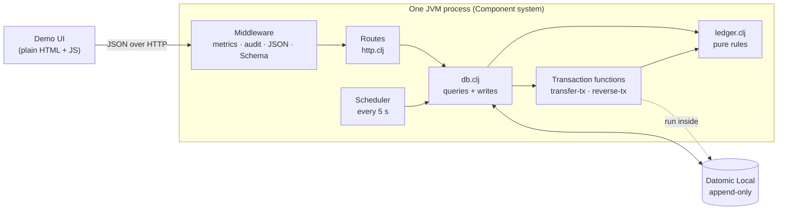
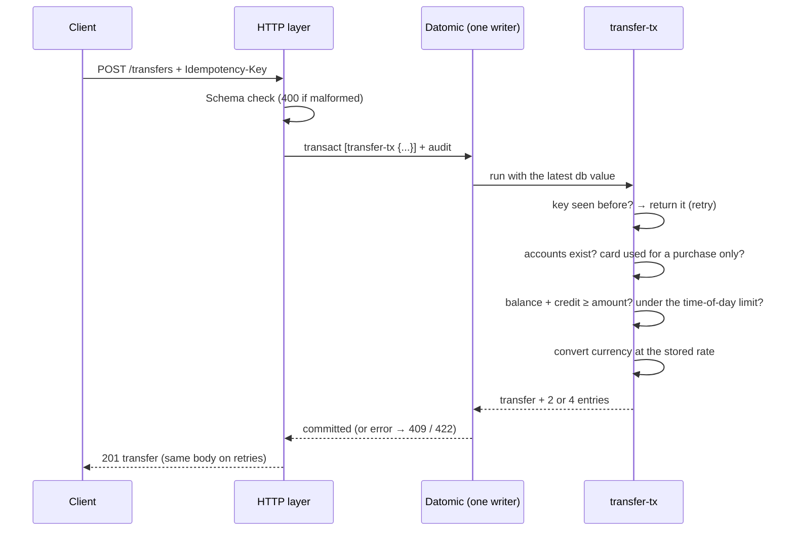
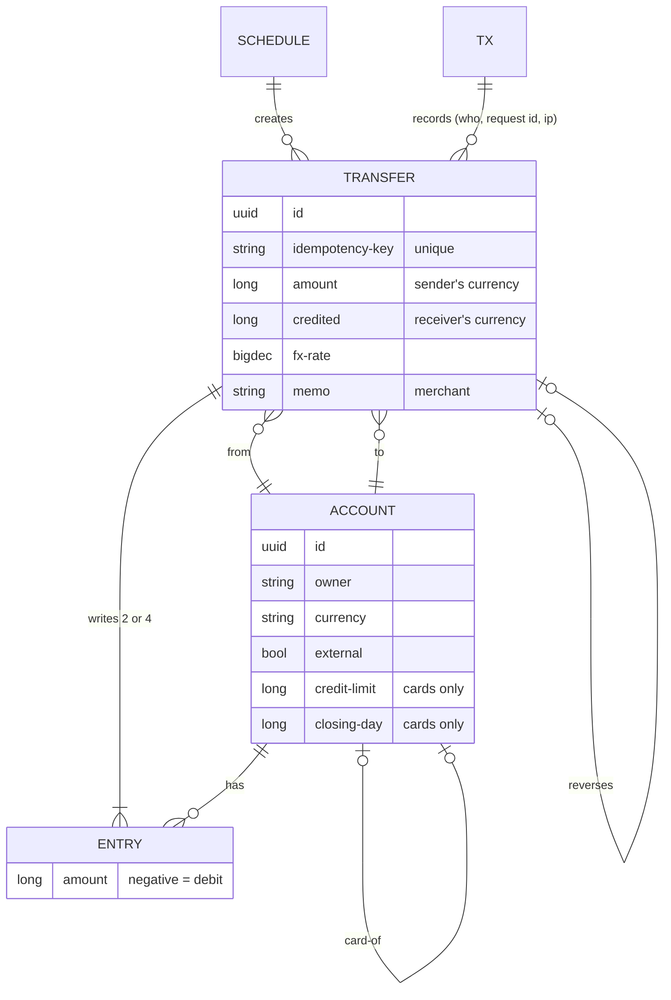

# How mini-nu works, and why

This is the longer version of the README's design table: the shape of the system, what happens on a transfer, and the trade-offs I made on purpose.

## The pieces

- **`ledger.clj` has no database.** Validation, double entry, currency conversion, limit periods and bill cycles are plain functions, so the most important rules are the easiest to test.
- **`db.clj` owns Datomic.** Reads are queries. Every write that moves money goes through a *transaction function* that Datomic runs inside the transaction.
- **`http.clj` is thin.** Schemas reject malformed requests (400) before any handler runs. The ledger rejects requests that break a business rule (422).
- **`system.clj` wires it with Component.** The database starts first, then the scheduler and web server that depend on it, and they stop in reverse order. Tests start a whole system on a random port and stop it.

## What happens on a transfer

Datomic applies transactions one at a time. Because the checks run *inside* the transaction, no other transfer can slip in between "is there enough money?" and "move it". That covers the balance, the night limit and the credit limit with no locks and no retry loops. The tests fire 100 concurrent transfers at one account and check none overdraw, and 40 at the limit and check exactly the allowed amount goes through.

## Data model

There is no balance column. A balance is always the sum of an account's entries, so it can't drift away from the history.

## Decisions and trade-offs

**Double entry, including across currencies.** A USD→BRL transfer writes four entries: Gui's USD out, the bank's USD in, the bank's BRL out, Mom's BRL in. Each currency sums to zero on its own, and a property test checks that after random transfers.

**Deposits and purchases are transfers too.** A deposit comes from the bank's account in that currency. A card purchase goes *to* the bank, which settles with the merchant. One code path, one set of checks.

**A credit card is just an account allowed below zero.** The balance is what's owed (negative). "Available credit" is the balance plus the limit, and that's the number the overdraft check uses. A card can't send money to people, only pay for purchases.

**The bill comes from history.** The closed bill is the card's balance *as of* its closing time, a direct `d/as-of` query. What's still due is that amount minus credits (payments and refunds) since closing. Credits go to the oldest bill first, as on a real card.

**Night limits are checked inside the transaction.** The limit is a total per period (06:00–20:00 and 20:00–06:00 in the customer's local time zone), not per transfer, so ten small transfers can't get around it. Brazil's Pix has the same rule: a phone stolen at 2am can't drain the account. Deposits and reversals don't count toward the limit.

**Idempotency lives in the database.** The key is a unique attribute, and the retry check happens inside the same transaction. A retried request returns the original transfer even after the limit is used up. Scheduled runs use `schedule-id + run time` as the key, and the schedule moves on with a compare-and-swap, so a crash or a second scheduler can't pay twice.

**Audit data sits on the transaction.** Who, from which IP and with which request id are stored on Datomic's transaction entity, in the same atomic write as the money movement.

**Integer cents, banker's rounding.** No floating point near money. HALF_EVEN rounding avoids a small bias that would add up over millions of conversions.

## Known limits

| Shortcut | Fine because | What I'd do at scale |
|---|---|---|
| Balances are summed from all entries | Thousands of entries per account sum in milliseconds | Snapshot balances per period, or a balance index updated in the same transaction |
| Statements filter and page in memory | Same | Use `index-range` on the transaction time |
| Metrics live in one process | One instance | Prometheus export, shared across instances |
| Limits and card terms are constants | One product | Store them per customer, with history, like FX rates |
| The actor comes from a header | It's a demo | Authentication, with the actor taken from the verified identity |
| FX rates are set by hand | It's a demo | Live quotes with an expiry, and the quote id stored on the transfer |
| Card bills have no interest or minimum payment | Not needed to show the ledger | A monthly job that posts interest as entries, idempotent per bill |
